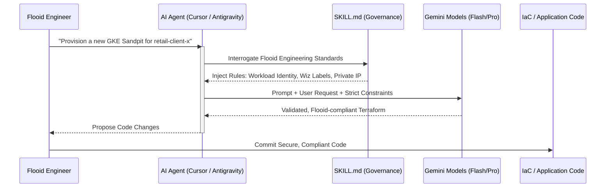

# 🧠 Flooid Demo: Embedding GCP Best Practices into Agentic Workflows

**Track 4: Context Engineering for the 3-Model Autonomous Code Factory**

This repository demonstrates how Flooid can bridge its "Flow Next" factory, Cursor, and Google Antigravity by injecting codified GCP engineering standards directly into the AI's context window.

---

## 🏛️ The Agentic Flow: Shifting Governance Left

Generic AI coding assistants write *generic* code. By embedding a `SKILL.md` file in the development environment, we enforce **Context Engineering**. The AI agent reads these organizational rules *before* it begins planning or writing, ensuring the generated code is instantly compliant with Flooid's proprietary standards.

---

## 📦 Codified Standards in Action

The embedded [**`SKILL.md`**](./SKILL.md) file acts as the explicit governance brain for the AI. It currently enforces:

### 1. 🛡️ Strict Tenant Isolation
*   **Action:** Prevents the AI from generating shared or overly permissive service accounts.
*   **Enforcement:** Requires explicit Workload Identity bindings (`roles/iam.workloadIdentityUser`) and strictly namespace-scoped RBAC (`Role` and `RoleBinding`).

### 2. 🔒 Security & Compliance (Wiz Integration)
*   **Action:** Ensures seamless integration with Cloud Security Posture Management.
*   **Enforcement:** Mandates specific annotations/labels on all resources (`flooid.com/security-scan: wiz-enforced`), VPC-native GKE clusters, and strictly private IPs for Cloud SQL.

### 3. ⚖️ Tokenomics & Model Routing
*   **Action:** Optimizes high-volume agentic token spend across the 3-model factory.
*   **Enforcement:** Directs the agent to route simple tasks (unit testing, syntax) to **Gemini 1.5 Flash** and complex architectural/adversarial tasks to **Gemini 1.5 Pro**.

### 4. ⏳ Ephemeral "Sandpit" Rules
*   **Action:** Controls cloud spend for temporary testing environments.
*   **Enforcement:** If a request involves a "sandpit", the AI automatically sets cost-effective sizing (e.g., `db-custom-2-7680`) and attaches a Time-To-Live label (`flooid.com/ttl: 12h`) for automated garbage collection.

---

## 💡 Strategic Impact for Flooid

*   **Zero-Day Compliance:** Security isn't a checklist step at the end of the pipeline; it is natively generated by the AI on keystroke one.
*   **Developer Velocity:** Engineers do not need to memorize the exact Workload Identity syntax or Wiz label requirements. The AI handles the boilerplate compliance, letting the engineer focus on business logic.
